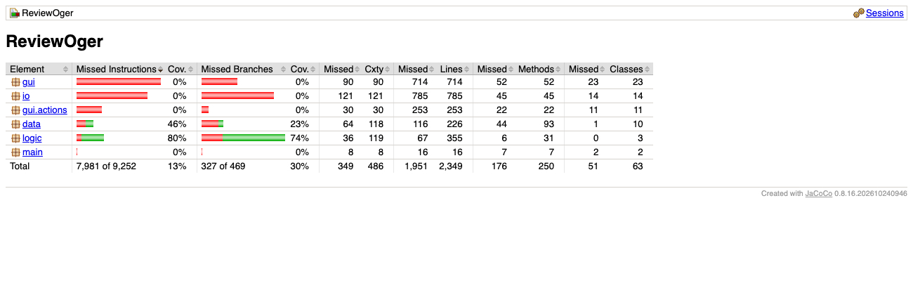
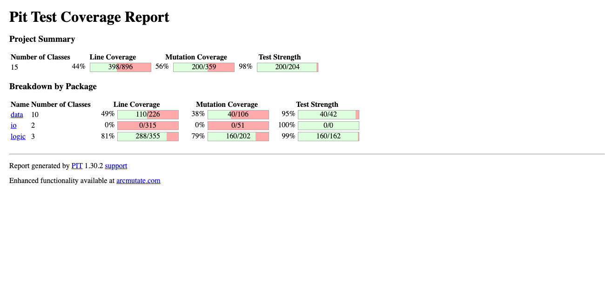
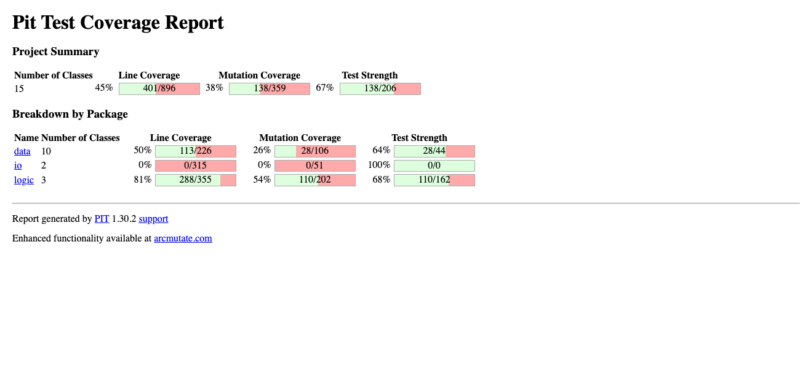
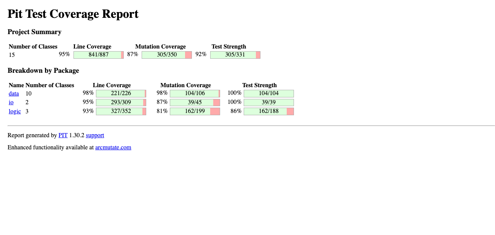
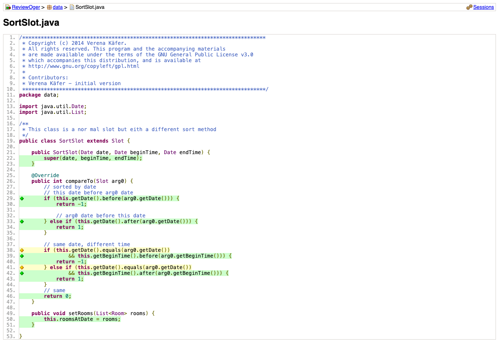
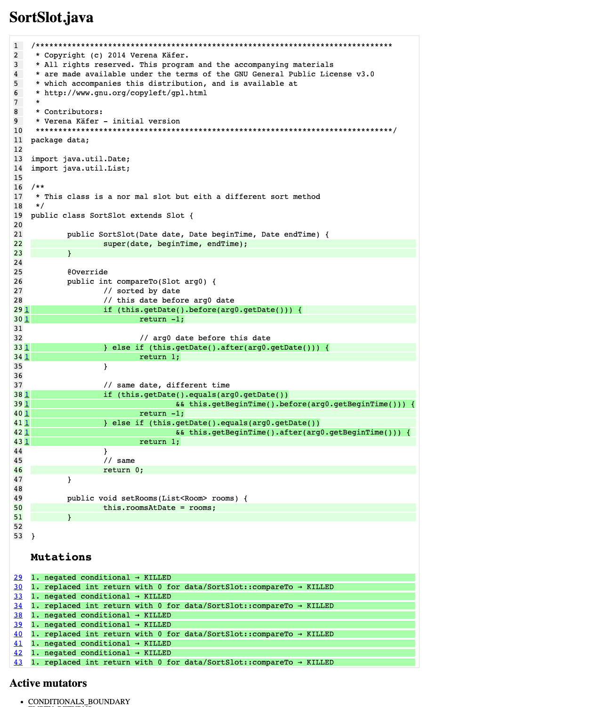
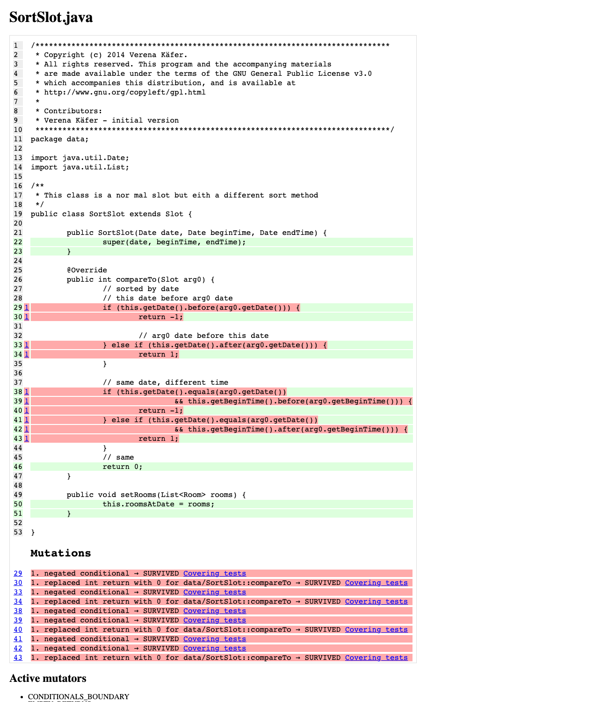
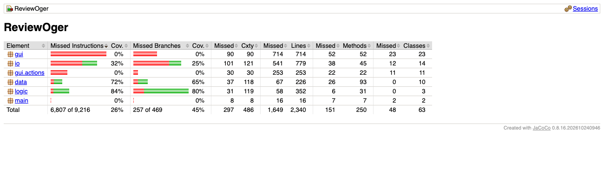
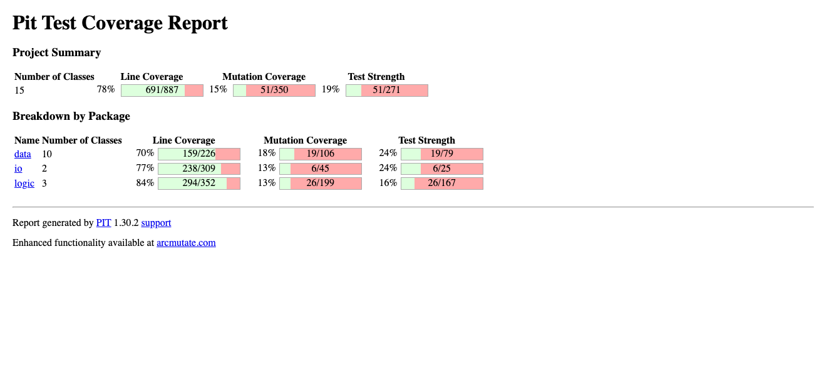

# Exercise 3 – Code Coverage (JaCoCo) and Mutation Testing (PIT) for ReviewOger

Architecture of Information Systems, Winter 2026/27

All numbers below come from the generated reports (JaCoCo `report.xml`,
PIT `mutations.xml`). The "before" reports are kept in
[`reports-before/`](reports-before/), the experiment reports in
[`experiment/`](experiment/), and the current reports are produced by the
build in `reports/` (and archived by Jenkins).

| Tool | Version |
|---|---|
| JDK | OpenJDK 21.0.9 (classes compiled with `release="17"`) |
| Ant | 1.10.18 |
| JUnit | 4.13.2 (the version ReviewOger's test already used) |
| JaCoCo | 0.8.16 (official distribution ZIP) |
| PIT | 1.30.2 |

---

## 1. JaCoCo setup

1. **Downloaded** the official distribution `jacoco-0.8.16.zip`
   (SHA-1 `abd615d11b2adef760a3c67735c34c39f1983022`, verified against
   Maven Central) and copied `jacocoant.jar`, `jacocoagent.jar` and
   `jacococli.jar` to [`tools/jacoco/lib/`](../../tools/jacoco/lib/).
   The jars are committed so they are also available inside the Jenkins
   Docker container.
2. **Declared the Ant tasks** in `build.xml`: the root element got
   `xmlns:jacoco="antlib:org.jacoco.ant"` and a project-level
   `<taskdef uri="antlib:org.jacoco.ant" …>` pointing to
   `tools/jacoco/lib/jacocoant.jar`.
3. **Instrumented the test run.** ReviewOger's original `build.xml` had no
   test target, so one was added:
   * `compile-tests` compiles `test/` into `build-test/` (kept separate from
     `build/`, so the dist jar and SpotBugs only see production classes).
   * `test` runs JUnit **forked** (`fork="true" forkmode="once"`) inside
     `<jacoco:coverage destfile="reports/jacoco/jacoco.exec">`, headless
     (`java.awt.headless=true`) because the code touches Swing models.
4. **Report target** `coverageReport` (depends on `test`) runs
   `<jacoco:report>` with `build/` as class files and `src/` as source
   files, and writes `reports/jacoco/html/`, `report.xml` and `report.csv`.
   If a test fails, the build still fails – but only *after* the report is
   written, so Jenkins can show the coverage of a red build.
5. `coverageReportPseudo` produces the same report for the pseudo-tests only
   (`reports/jacoco-pseudo/`).

Commands:

```bash
ant clean
ant dist
ant coverageReport            # tests + JaCoCo report
ant coverageReportPseudo      # pseudo-test experiment
ant pit                       # mutation testing (real tests)
ant pit-pseudo                # mutation testing (pseudo-tests only)
open reports/jacoco/html/index.html
```

## 2. Initial coverage

The original suite is a single test, `MatcherTest.testCalculatedResults`,
which runs the matching algorithm 2 × 1000 times on `res-test/reviews.oger`.



| Package | Line | Branch |
|---|---:|---:|
| `data`  | 48.7% (110/226) | 23.4% (11/47) |
| `logic` | 81.1% (288/355) | 74.4% (131/176) |
| `io`    | 0.0% (0/785) | 0.0% (0/152) |
| `gui`, `gui.actions`, `main` | 0% | 0% |

## 3. What needed more tests

From the red/yellow lines in the initial report:

* **`io` – nothing tested at all**: CSV import (`FileProcessor.processLine`,
  `readParticipantList`, the error log), the result files
  (`printResult`, `printResultNoMail`) and the LaTeX overview
  (`TableOutputter.createArray`, `createTable`).
* **`data`**: `SortSlot.compareTo` (0%), `SlotNode`/`RoomNode.toString`,
  all of `ParticipantTableModel` except `addParticipant`, `Slot`/`Room`
  setters and formatting, `RoomTreeModel.hasReviews`.
* **`logic`**: `RandomFunctions.shuffleReviews` (never called by the test),
  the "already in this review" branch of `Pool`, the moderator pool with
  `moderatorNotReviewerGroup = false`, `Matcher.call()` / `setLetters`
  (the entry point the GUI actually uses).
* `gui.*` and `main.*` were left out on purpose: they open Swing windows and
  cannot run in the headless CI container.

## 4. New unit tests

72 tests in total (1 original + 71 new), all JUnit 4, in the package of the
class under test. [`test/testutil/AppState.java`](../../test/testutil/AppState.java)
resets the application singletons before/after each test.

| Test class | Tests | What they verify |
|---|---:|---|
| `MatcherTest` (original, extended) | 1 | Added a state reset and, for the author-as-scribe run, that every participant has exactly 2 reviews and that `numberOfReviews` matches the assigned reviews |
| `data.ParticipantTest` | 5 | constructor/setters, participation counter, review list, `compareTo` sorts by group (descending) so groups are adjacent |
| `data.ReviewTest` | 5 | author/group taken from author, role/room assignment, reviewer added only once, `removeReviewer` result, `ReviewPlan` final vs. temporary list |
| `data.SlotAndRoomTest` | 12 | room/slot fields and setters, `"Raum A1 von 10:00 Uhr bis 11:30 Uhr"` formatting, `Slot.compareTo` (more rooms first, all 3 outcomes), `SortSlot.compareTo` (date, then begin time, all 5 outcomes), tree nodes (`isLeaf`, `toString`, root = "Slots"), `RoomTreeModel.hasReviews` |
| `data.ParticipantTableModelTest` | 6 | column names incl. invalid column, cell values, add/delete/clear **fire table events** (checked with a `TableModelListener`) |
| `logic.PoolTest` | 15 | reviewer pool rules one by one: author group, 2-review limit, already in review, busy in same slot, overlapping time (inside / outside), unplaced author review; moderator pool with and without the "not a reviewer group" option; `ParticipantInSlot` for every role and with an empty first room |
| `logic.RandomFunctionsTest` | 3 | selected reviewer is from the pool and removed (no one drawn twice); moderator stays in pool; `shuffleReviews` keeps every review exactly once, clears the assignment and stale temp entries |
| `logic.MatcherScenarioTest` | 9 | 12 students / 4 groups / 2 slots × 2 rooms: valid plan for both scribe options (no own-group reviews, no double roles, 2 reviews each, never twice per slot); slots sorted by room count; one review per group with an unsorted participant list; `call()` assigns letters A–D; failing rounds return `null`; a second calculation does not duplicate rooms |
| `io.FileProcessorTest` | 12 | CSV line → trimmed participant, `"05"` → group `"5"`, blank lines, missing fields, non-numeric group, whole-file import, error log with line numbers, both result files line by line (incl. "Beamer benötigt", missing roles, names without spaces), error dialogs for missing/unwritable files |
| `io.TableOutputterTest` | 4 | letter matrix (`-` unused room, `null` room not offered), complete LaTeX table sorted by date, single-slot table, error dialog for an unwritable file |

Error dialogs (`JOptionPane`) cannot be clicked in CI; in headless mode they
throw `HeadlessException`, which the tests use as proof that the user would
have been informed.

### Bugs found by the new tests (and fixed)

| Test that failed | Bug | Fix |
|---|---|---|
| `MatcherScenarioTest.runningANewCalculationDoesNotDuplicateRooms`, extended `MatcherTest` | `Matcher.sortSlots()` appended the rooms to the `Slot` objects again on every new calculation → a second run in the GUI gave students **4** reviews instead of 2 | clear the slot's room list before rebuilding it |
| `RandomFunctionsTest.shuffleMovesEveryReviewExactlyOnceAndClearsTheAssignment` | `shuffleReviews` drew with `get()` instead of `remove()` → reviews duplicated / lost (6 in, 4 distinct out) | draw without replacement |
| `TableOutputterTest.createTableWorksWithASingleSlot` | loop bound `array[1].length` → `ArrayIndexOutOfBoundsException` with one slot | `array[slotCounter].length` |

## 5. Updated coverage


| Measurement | Before additional tests | After additional tests |
|---|---:|---:|
| Line coverage (whole project) | 16.9% (398/2349) | 35.7% (835/2340) |
| Branch coverage (whole project) | 30.3% (142/469) | 55.9% (262/469) |
| Instruction coverage (whole project) | 13.7% (1271/9252) | 31.2% (2875/9216) |
| Method coverage (whole project) | 29.6% (74/250) | 52.8% (132/250) |
| Line coverage `data` / `logic` / `io` | 48.7% / 81.1% / 0.0% | 97.8% / 92.9% / 36.8% |
| Branch coverage `data` / `logic` / `io` | 23.4% / 74.4% / 0.0% | 95.7% / 90.3% / 38.2% |
| Mutation coverage (PIT, detected / generated) | 55.7% (200/359) as reported – **38.4% (138/359)** real, see below | **87.1% (305/350)** |
| Survived mutations | 4 as reported – **68** real | **26** |
| Mutants without coverage | 155 | 19 |

The whole-project numbers stay low because `gui`, `gui.actions`, `main` and
the Swing dialogs in `io` (`EmailDelivery`, `LoadSave`, `IODialog`, file
filters) are roughly 1,500 lines that need a display. The line totals differ
slightly because the cleanup removed a few lines of production code.

### Why "before" has two PIT values

| PIT run on the original test | Detected | Survived | No coverage | Test strength |
|---|---:|---:|---:|---:|
| original `MatcherTest` as supplied | 200 / 359 | 4 | 155 | 98% |
| same test + only a singleton reset | 138 / 359 | 68 | 153 | 67% |




PIT runs many mutants in the same JVM. The original `MatcherTest` loads 108
participants into the `ParticipantTableModel` singleton and never clears it,
so from the second mutant on its first assertion (`size == 108`) failed
**regardless of the mutation**. This test pollution inflated the result by
62 "kills" – even mutants that change nothing were reported as killed (e.g.
removing the redundant `review.setAuthor(...)` calls; the `Review`
constructor already sets the author). The reset makes the test repeatable
and shows the real starting point.



The 26 remaining survivors were inspected; they are equivalent or not worth
a test: `>=` boundaries in `Matcher.fillReview` (if the pool has exactly as
many people as reviewers are needed, the moderator pool is empty and the
review fails either way), the reset calls on a failed round (the next round
resets everything), `!= null` checks on the author (always set), `size() > 0`
before `contains()`, and `matchExtraReviewers`, which only matters with
groups of different size. Survivors that pointed at dead code were fixed by
removing it (redundant `setAuthor` calls, debug `System.out.println`, and
`println(e.getStackTrace())` – the same lines SpotBugs reports as
`DMI_INVOKING_TOSTRING_ON_ARRAY` in exercise 2).

## 6. Pseudo-test experiment

### 6.1 One test replaced (as described in the exercise)

`SlotAndRoomTest.sortSlotOrdersByDateThenBeginTime` was temporarily
replaced by a pseudo-test, both versions were measured with JaCoCo and PIT
(target class `data.SortSlot`, only this test class), and the proper test
was restored afterwards.

**Proper test**

```java
@Test
public void sortSlotOrdersByDateThenBeginTime() {
    SortSlot dec1Early = sortSlot("01.12.26", "08:00");
    SortSlot dec1Late = sortSlot("01.12.26", "10:00");
    SortSlot dec2 = sortSlot("02.12.26", "08:00");

    assertEquals(-1, dec1Early.compareTo(dec2));
    assertEquals(1, dec2.compareTo(dec1Early));
    assertEquals(-1, dec1Early.compareTo(dec1Late));
    assertEquals(1, dec1Late.compareTo(dec1Early));
    assertEquals(0, dec1Early.compareTo(sortSlot("01.12.26", "08:00")));
}
```

**Weak pseudo-test** (full file: [`experiment/SlotAndRoomTest.pseudo.java`](experiment/SlotAndRoomTest.pseudo.java))

```java
@Test
public void sortSlotOrdersByDateThenBeginTime() {
    SortSlot dec1Early = sortSlot("01.12.26", "08:00");
    SortSlot dec1Late = sortSlot("01.12.26", "10:00");
    SortSlot dec2 = sortSlot("02.12.26", "08:00");

    // PSEUDO-TEST: same calls, results are never checked
    dec1Early.compareTo(dec2);
    dec2.compareTo(dec1Early);
    dec1Early.compareTo(dec1Late);
    dec1Late.compareTo(dec1Early);
    dec1Early.compareTo(sortSlot("01.12.26", "08:00"));
}
```

| `data.SortSlot` | Proper test | Pseudo-test |
|---|---:|---:|
| Line coverage (JaCoCo) | 100% (15/15) | 100% (15/15) |
| Branch coverage (JaCoCo) | 83.3% (10/12) | 83.3% (10/12) |
| Instruction coverage (JaCoCo) | 100% (56/56) | 100% (56/56) |
| Mutations killed (PIT) | **10 / 10** | **0 / 10** |
| Mutations survived (PIT) | 0 | 10 |

JaCoCo cannot tell the two tests apart – every line is green in both cases:



PIT can: with the proper test every mutant is killed, with the pseudo-test
every mutant (negated conditions, `return 0` instead of `-1`/`1`) survives.

| Proper test | Pseudo-test |
|---|---|
|  |  |

### 6.2 A whole pseudo-test suite

[`test/pseudo/CoverageOnlyPseudoTest.java`](../../test/pseudo/CoverageOnlyPseudoTest.java)
contains 4 tests that call the data model, the matcher, the pools and the
file output **without a single assertion**. It is kept as a documented
experiment and is excluded from `test`, `coverageReport` and `pit`.

| Measurement | Proper tests (72) | Pseudo-tests (4) |
|---|---:|---:|
| Line coverage (JaCoCo, project) | 35.7% (835/2340) | 29.5% (691/2340) |
| Branch coverage (JaCoCo, project) | 55.9% (262/469) | 45.2% (212/469) |
| Line coverage `logic` | 92.9% | 83.5% |
| Mutations killed (PIT) | 305 / 350 (87.1%) | 51 / 350 (14.6%) |
| Mutations survived (PIT) | 26 | 220 |




Four assertion-free tests reach about 83% of the line coverage of the 72
real tests, but kill only a sixth as many mutants. Most of the 51 they do
kill make the code crash – e.g. 24 are "return `null`" mutants that end in a
`NullPointerException`, which fails a test even without assertions.
**Coverage only shows what was executed; mutation testing shows what was
actually checked.**

## 7. Jenkins

The pipeline ([`Jenkinsfile`](../../Jenkinsfile)) keeps the stages of
exercises 1 and 2 and adds:

| Stage | Command | Output |
|---|---|---|
| Unit Tests & Coverage | `ant coverageReport` | JUnit results (published with the `junit` step), `reports/jacoco/**` |
| Mutation Testing | `ant pit`, `ant pit-pseudo`, `ant coverageReportPseudo` | `reports/pit/**`, `reports/pit-pseudo/**`, `reports/jacoco-pseudo/**` |
| Archive Results | `archiveArtifacts` | SpotBugs, JUnit, JaCoCo and PIT reports (downloadable from each build page) |

JaCoCo comes from `tools/jacoco/lib` in the repository; JUnit and PIT are
downloaded once by the `resolve` target into `lib-test/` in the Jenkins
workspace.

> **TODO (screenshot):** add a screenshot of a green Jenkins build showing the
> "Unit Tests & Coverage" and "Mutation Testing" stages and the archived
> `reports/jacoco/html/index.html` artifact.

## 8. Checklist

- [x] ReviewOger builds successfully before JaCoCo integration (`ant clean dist`)
- [x] JaCoCo Ant task configured in `build.xml`
- [x] Existing JUnit test runs with JaCoCo instrumentation
- [x] Execution data file generated (`reports/jacoco/jacoco.exec`)
- [x] HTML coverage report generated and inspected
- [x] Poorly covered methods and branches identified (section 3)
- [x] Additional unit tests written (71 new)
- [x] All tests pass
- [x] Coverage before and after recorded (section 5)
- [x] PIT run again after adding tests
- [x] Pseudo-test experiment performed and documented (section 6)
- [x] Proper test restored in the final version
- [ ] Jenkins archives the JaCoCo report – configured; screenshot of a CI run still to be added
